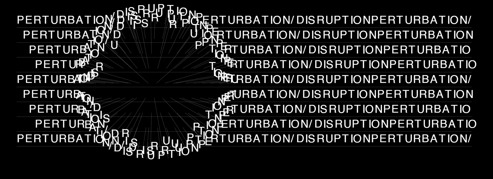
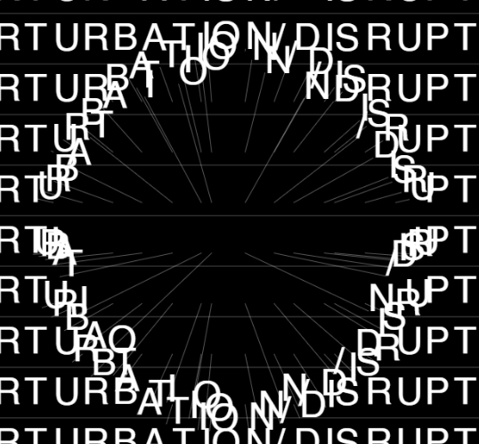
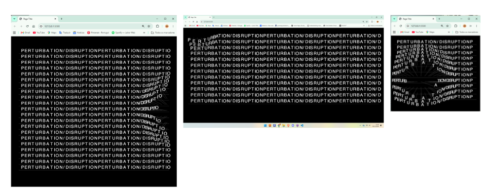
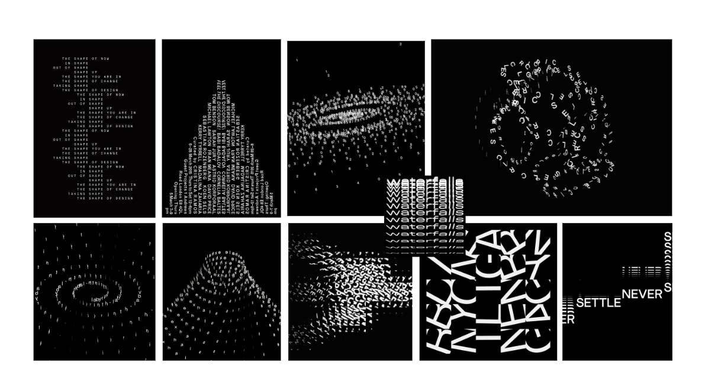
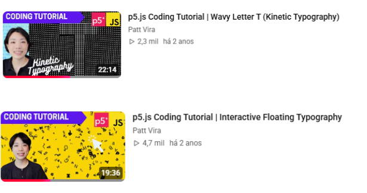

# Cartaz tipográfico interativo

# Conceito
A tipografia é tratada como um material sensível ao gesto.

# Interações
**1**- Mover o rato	

As letras próximas afastam-se.

**2** - Clicar e manter

A perturbação fica mais forte

**3** - Redimensionar a janela

A composição ajusta-se ao tamanho da janela. 

# Pesquisa

**MoodBoard**

Link's que me ajudaram no desenvolvimento deste projeto 
**Canal da Patt Vira** https://www.youtube.com/@pattvira

Ela tem um canal focado em código criativo, e ver alguns dos vídeos dela relacionados com tipografia ajudou-me a concretizer este projeto. 

